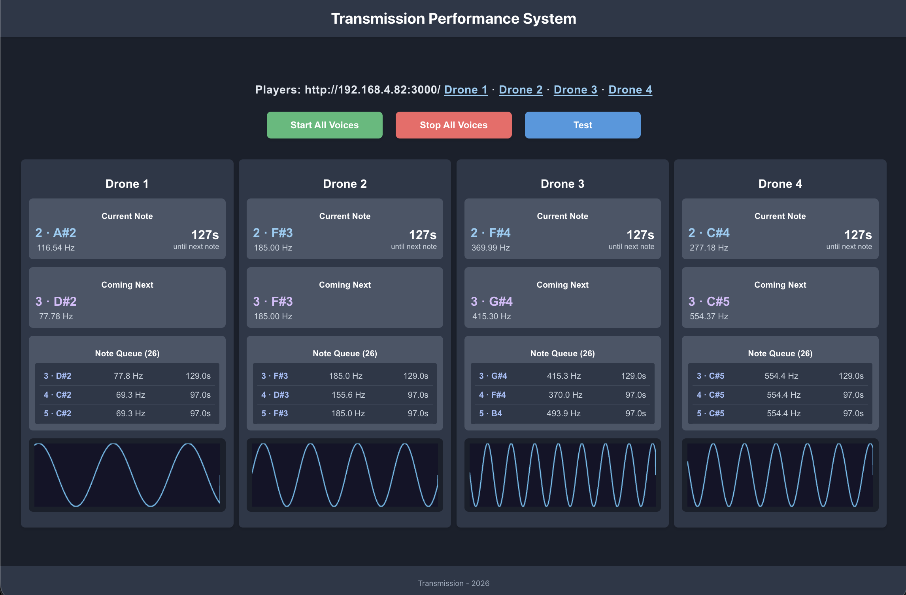
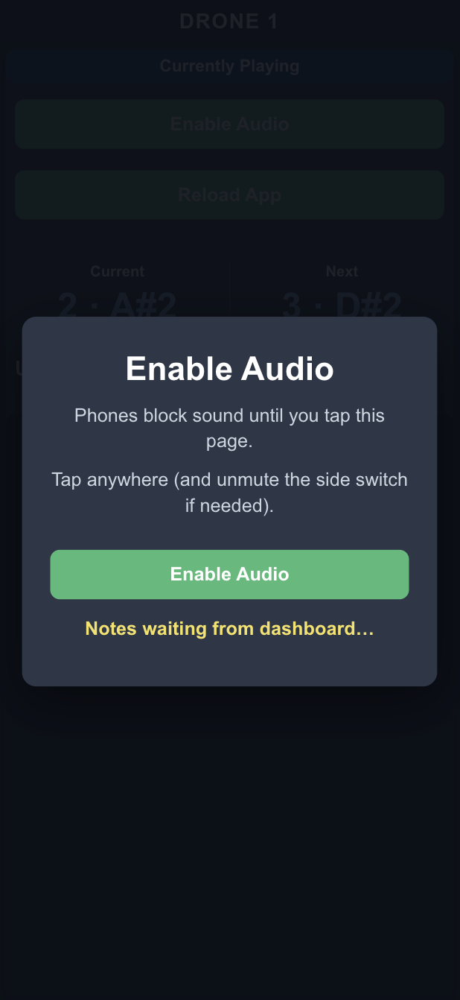
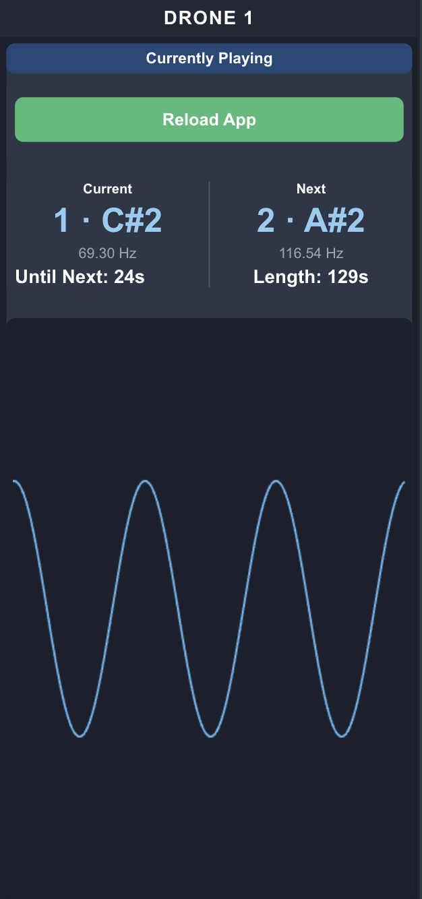

# Transmission Performance System

The dashboard controls four drones. Each phone opens one drone page and plays only that part.

## Start

Use two terminals in the `Dashboard` folder.

```bash
node socket-server.js
```

```bash
npm start
```

The socket server listens on port 8080. The dashboard opens at http://localhost:3000.



*Dashboard: four drones, player links, and the main controls.*

## Phones

The dashboard shows the address for this computer. On each phone, open one of these pages and tap **Enable Audio** before expecting sound:

- Drone 1 — `http://APP_URL/?drone1`
- Drone 2 — `http://APP_URL/?drone2`
- Drone 3 — `http://APP_URL/?drone3`
- Drone 4 — `http://APP_URL/?drone4`

The phone must be on the same network as the computer.

<p>


</p>

*Left: tap Enable Audio before the phone can play. Right: the drone page, with the current note, the next note, and the waveform.*

## Controls

- **Test** plays that drone's note for 10 seconds.
- **Start All Voices** plays the 28 drone chords in order, then loops back to chord 1. Each phone follows its own part.
- **Stop All Voices** fades every drone out over 5 seconds, on the dashboard and on the phones.

## If a phone is silent

1. Tap **Enable Audio**, or **Reload App**.
2. On the dashboard, press **Stop All Voices**, then **Test** or **Start All Voices**.
3. If it is still silent, stop both terminals and start `node socket-server.js` and `npm start` again.
